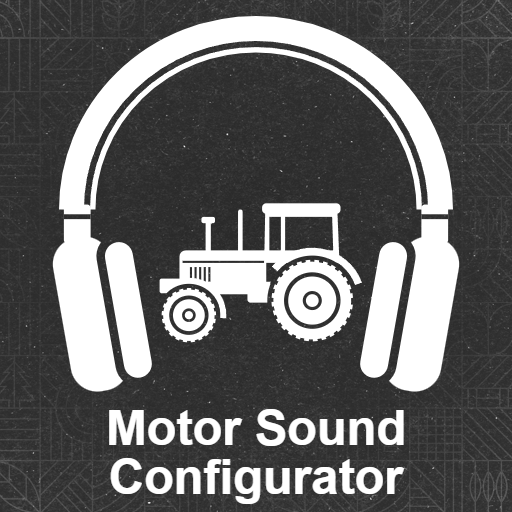

# Motor Sound Configurator (FS25)

**English** · [Deutsch](#deutsch)

Script mod for **Farming Simulator 25** (PC / Mac): adjust the engine, transmission, cabin and work sounds of your
vehicles directly in game, without editing sound XML files. Download: GIANTS ModHub. This repository holds the source.

## Features

- **Alt + M** (controller: assign a button in Options > Controls) in a vehicle opens the configurator, every change is audible immediately
- **Presets** for the vehicle model (punchier, more bass, insulated cabin …), combinable
- **Engine swap**: replace the engine sound of a vehicle model completely with the engine of another base game vehicle
- **Engine & gearbox**: volume, pitch & speed, RPM character
- **Other sounds**: volume of cabin & fan, parts rattle, work sounds of harvesters, attached implements (work, drive) and trailers (driving rattle)
- **Filter**: how open the cabin sounds (up to "like outside"), tone and presence in the cabin and outside
- **Extra sounds**: mix in exhausts, engines and transmissions of other base game vehicles
- **Preview** at any RPM / load while standing still, **hear original** to compare
- Settings for **all vehicles** or for **one vehicle model**, relative to the original sound (100 % = original)
- Saved per savegame; multiplayer: every player has their own settings, nothing is synchronized
- Mouse, keyboard or controller; help line in the menu, English and German

## Installation

1. Copy `FS25_MotorSoundConfigurator.zip` into the mods folder:
   `Documents\My Games\FarmingSimulator2025\mods`
2. Activate the mod when loading the savegame.
3. Get into a motorized vehicle and press **Alt + M** (controller: assign a button in *Options → Controls*, "Adjust engine sound").

Full guide: **[docs/GUIDE.md](docs/GUIDE.md)**

## Building from source

- Windows PowerShell, the game must be closed:
  `powershell -ExecutionPolicy Bypass -File build.ps1`
  Checks all XML files, creates `FS25_MotorSoundConfigurator.zip` in the mods folder and only packs `modDesc.xml`,
  the icon, `src/`, `l10n/`, `gui/` and `sounds/` (only file types the game loads, as required by the GIANTS
  TestRunner).
- Load order of the Lua files: `modDesc.xml` (`extraSourceFiles`). Extra sounds: catalog `sounds/layers.xml`, only base
  game sounds via `$data/...`.
- Icon: `tools/make_icon.ps1` puts `assets/icon_source_transparent.png` on the official ModHub icon template of GIANTS
  (not included here, available from GIANTS).
- Mod messages are written to `Documents\My Games\FarmingSimulator2025\log.txt` with the prefix
  `[MotorSoundConfigurator]`. Console commands (`mscInfo`, `mscSet`, `mscLayer`, `mscDebug` …) see the guide.

## Thanks

These community projects were a great help as reference and source during development:

- [FS25-Community-LUADOC](https://github.com/umbraprior/FS25-Community-LUADOC) (umbraprior): documentation of the
  FS25 Lua classes with signatures and code, the main basis for the game functions used.
- [FS25-lua-scripting](https://github.com/Dukefarming/FS25-lua-scripting) (Dukefarming): Lua source of the game, to
  look up how the game itself implements sounds, dialogs and vehicles.
- [FS25_AI_Coding_Reference](https://github.com/Seamforge/FS25_UsedPlus/tree/master/FS25_AI_Coding_Reference)
  (Seamforge, part of FS25_UsedPlus): collection of modding patterns and pitfalls, plus the UsedPlus mod itself as
  a model for the dialog. Note from development: some function signatures and examples did not match the current
  game code. The collection was therefore most valuable as a source of ideas; every detail was checked against the
  LUADOC and the game sources.
- [fs25-skills](https://github.com/Paint-a-Farm/fs25-skills) (Paint-a-Farm): FS25 modding knowledge (packaging,
  scripting, vehicle XML, debugging) for AI assistants.
- [fs-utils](https://github.com/scfmod/fs-utils) (scfmod): command line tools for the game files, e.g. to decompile
  the Lua scripts and unpack the game archives.

Many thanks to everyone who collected this knowledge and made it freely available.

## About this project

This mod was developed with the help of **Claude** (AI assistant by Anthropic). I am a software developer myself,
mainly in the embedded field, with about ten years of experience, and wanted to build a mod for one of my favourite
games. I deliberately used Claude to compare AI tools with my usual way of working, writing code by hand, and to
evaluate how to work with them.

## License

[GNU GPL v3](LICENSE) © 2026 Emme92: you may use, modify and redistribute the code. Anyone distributing a modified
version or a mod containing this code must release it under the GPL v3 as well, with source code, and mark the
changes. Applies to this mod's own files. Sounds and templates of the base game are only referenced via `$data/...`
and belong to GIANTS Software. The mod zip contains no `LICENSE` file (ModHub only allows game file types); every
Lua file and the mod description carry the GPL notice with a link to the license text.

---

## Deutsch

Script-Mod für den **Landwirtschafts-Simulator 25** (PC / Mac): Motor-, Getriebe-, Kabinen- und Arbeitsgeräusche
deiner Fahrzeuge direkt im Spiel einstellen, ohne Sound-XMLs zu bearbeiten. Download: GIANTS ModHub. Dieses Repository
enthält den Quellcode.

### Funktionen

- **Alt + M** (Controller: Taste unter Optionen > Steuerung belegen) im Fahrzeug öffnet den Configurator, jede Änderung ist sofort hörbar
- **Presets** für das Fahrzeug-Modell (kerniger, mehr Bass, gedämmte Kabine …), kombinierbar
- **Motor-Tausch**: den Motor-Sound eines Fahrzeug-Modells ganz durch den Motor eines anderen Basisspiel-Fahrzeugs ersetzen
- **Motor & Getriebe**: Lautstärke, Tonhöhe & Tempo, Drehzahl-Charakter
- **Geräusche**: Lautstärke von Kabine & Lüfter, Anbauteile-Klappern, Arbeitsgeräusche von Erntemaschinen, angehängte Anbaugeräte (Arbeit, Antrieb) und Anhänger (Fahr-Klappern)
- **Dämpfung**: wie offen die Kabine klingt (bis „wie draußen“), Klangfarbe und Präsenz in der Kabine und draußen
- **Zusatz-Sounds**: Auspuff, Motoren und Getriebe anderer Basisspiel-Fahrzeuge dazumischen
- **Vorschau** bei jeder Drehzahl / Last im Stand, **Original anhören** zum Vergleich
- Einstellungen für **alle Fahrzeuge** oder **ein Fahrzeug-Modell**, relativ zum Original-Sound (100 % = Original)
- Gespeichert pro Spielstand; Mehrspieler: jeder Spieler hat eigene Einstellungen, nichts wird synchronisiert
- Bedienung mit Maus, Tastatur oder Controller; Hilfezeile im Menü, Englisch und Deutsch

### Installation

1. `FS25_MotorSoundConfigurator.zip` in den Mod-Ordner kopieren:
   `Dokumente\My Games\FarmingSimulator2025\mods`
2. Mod beim Laden des Spielstands aktivieren.
3. In ein motorisiertes Fahrzeug steigen und **Alt + M** drücken (Controller: unter *Optionen → Steuerung* eine Taste belegen, „Motorsound einstellen“).

Ausführliche Anleitung: **[docs/ANLEITUNG.md](docs/ANLEITUNG.md)**

### Aus dem Quellcode bauen

- Windows PowerShell, Spiel muss geschlossen sein:
  `powershell -ExecutionPolicy Bypass -File build.ps1`
  Prüft alle XML-Dateien, erzeugt `FS25_MotorSoundConfigurator.zip` im Mod-Ordner und packt nur `modDesc.xml`, das
  Icon, `src/`, `l10n/`, `gui/` und `sounds/` (nur Dateitypen, die das Spiel lädt, wie es der GIANTS-TestRunner
  verlangt).
- Ladereihenfolge der Lua-Dateien: `modDesc.xml` (`extraSourceFiles`). Zusatz-Sounds: Katalog `sounds/layers.xml`, nur
  Basisspiel-Sounds über `$data/...`.
- Icon: `tools/make_icon.ps1` legt `assets/icon_source_transparent.png` auf die offizielle ModHub-Icon-Vorlage von
  GIANTS (hier nicht enthalten, bei GIANTS erhältlich).
- Meldungen der Mod stehen in `Dokumente\My Games\FarmingSimulator2025\log.txt` mit dem Präfix
  `[MotorSoundConfigurator]`. Konsolenbefehle (`mscInfo`, `mscSet`, `mscLayer`, `mscDebug` …) siehe Anleitung.

### Danke

Diese Community-Projekte waren bei der Entwicklung eine große Hilfe als Nachschlagewerk und Quelle:

- [FS25-Community-LUADOC](https://github.com/umbraprior/FS25-Community-LUADOC) (umbraprior): Dokumentation der
  FS25-Lua-Klassen mit Signaturen und Code, die wichtigste Grundlage für die verwendeten Spielfunktionen.
- [FS25-lua-scripting](https://github.com/Dukefarming/FS25-lua-scripting) (Dukefarming): Lua-Quelltexte des Spiels,
  um nachzusehen, wie das Spiel selbst Sounds, Dialoge und Fahrzeuge umsetzt.
- [FS25_AI_Coding_Reference](https://github.com/Seamforge/FS25_UsedPlus/tree/master/FS25_AI_Coding_Reference)
  (Seamforge, Teil von FS25_UsedPlus): Sammlung von Mustern und Stolperfallen beim Modden, dazu die Mod UsedPlus selbst
  als Vorbild für den Dialog. Hinweis aus der Entwicklung: Einzelne Funktionssignaturen und Beispiele passten nicht
  zum aktuellen Spielcode. Die Sammlung war deshalb vor allem als Ideenquelle wertvoll, jedes Detail haben wir gegen
  LUADOC und die Spielquellen geprüft.
- [fs25-skills](https://github.com/Paint-a-Farm/fs25-skills) (Paint-a-Farm): Wissenssammlung zum FS25-Modding
  (Packen, Scripting, Fahrzeug-XML, Debugging) für KI-Assistenten.
- [fs-utils](https://github.com/scfmod/fs-utils) (scfmod): Kommandozeilen-Werkzeuge rund um die Spieldateien, z. B.
  zum Dekompilieren der Lua-Skripte und Entpacken der Spielarchive.

Vielen Dank an alle, die dieses Wissen zusammengetragen und frei zugänglich gemacht haben.

### Entstehung

Diese Mod ist mit Unterstützung von **Claude** (KI-Assistent von Anthropic) entstanden. Ich bin selbst
Softwareentwickler, hauptsächlich im Embedded-Bereich, mit rund zehn Jahren Erfahrung, und hatte Lust, für eines
meiner Lieblingsspiele eine Mod zu bauen. Dabei wollte ich bewusst Claude einsetzen, um KI-Werkzeuge mit meiner
bisherigen Arbeitsweise, Code von Hand zu schreiben, zu vergleichen und den Umgang damit zu evaluieren.

### Lizenz

[GNU GPL v3](LICENSE) © 2026 Emme92: Du darfst den Code nutzen, ändern und weitergeben. Wer eine veränderte Fassung
oder eine Mod mit diesem Code weitergibt, muss sie ebenfalls unter der GPL v3 und mit Quellcode veröffentlichen und
Änderungen kenntlich machen. Gilt für die eigenen Dateien dieser Mod. Sounds und Templates aus dem Basisspiel werden
nur über `$data/...` referenziert und gehören GIANTS Software. Das Mod-Zip enthält keine `LICENSE`-Datei (der ModHub
erlaubt nur Spiel-Dateitypen); jede Lua-Datei und die Mod-Beschreibung tragen den GPL-Hinweis mit Link zum
Lizenztext.
